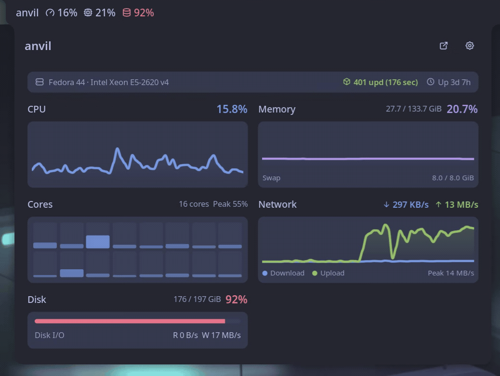

# Beszel Desktop

[](https://github.com/henriksvensson/beszel-desktop/actions/workflows/ci.yml)
[](LICENSE)

Live (~1 Hz) CPU, memory, and per-core telemetry from a [Beszel](https://beszel.dev) hub, brought directly into Linux Wayland desktop bars without recreating the full web dashboard.

Instead of giving every bar widget your Beszel credentials and opening duplicate connections, **Beszel Desktop** runs one lightweight per-user Rust daemon (`beszel-relay`) that authenticates with your hub and fans out live updates over a user-only Unix socket to any number of widgets or CLI tools.

<p align="center">
  
</p>

## Highlights

- **Slim, jitter-free bar pills:** Compact `<host>` + CPU/RAM icons with fixed-width zero-padded percentages (`00%`–`99%`) and smooth severity coloring (amber warning, red danger).
- **Real-time popout telemetry:** Hover-scrubbable CPU & memory area sparklines with outage gap breaks and an animated per-core CPU heatmap.
- **Multi-host out of the box:** Watches Beszel's `systems/*` collection live so hosts coming online or going offline update automatically; place independent bar widgets per host.
- **Credentials never touch widgets:** Passwords stay inside `beszel-relay`, encrypted at rest via `systemd-creds` (TPM2 + host key when available). Widgets read only from a `0600` Unix socket under `$XDG_RUNTIME_DIR`.
- **Laptop & server friendly:** Automatically pauses upstream `rt_metrics` polling when no widgets are connected (e.g., locked/closed shell) and detects wake-from-sleep clock jumps for instant reconnects.

## Supported Desktop Shells

| Shell | Minimum Version | Features | Setup Guide |
| --- | --- | --- | --- |
| **DankMaterialShell (DMS)** | DMS `>= 2.0` / Quickshell `0.3+` | Direct Unix socket, one-click host discovery & variants, sparklines, per-core heatmap | [shells/dms/README.md](shells/dms/README.md) |
| **Noctalia Shell v5** | Noctalia `v5.5+` (`plugin_api = 48`) | Singleton Luau service, per-instance bar pills, attached telemetry panel & heatmap | [shells/noctalia/README.md](shells/noctalia/README.md) |
| **Waybar** | Waybar `0.15+` | Continuous JSON stream via `beszel-ctl waybar` with `warning`/`danger`/`stale` CSS classes | [shells/waybar/README.md](shells/waybar/README.md) |

## Quick Start

### Prerequisites

- A [Beszel](https://beszel.dev) hub and agents running `>= 0.13.0` (verified on `0.21.2`).
- Rust toolchain (`cargo`) to build from source (or prebuilt Linux tarballs from [GitHub Releases](https://github.com/henriksvensson/beszel-desktop/releases)).
- `systemd >= 256` recommended for encrypted user credentials (`password_file` and environment variables are also supported).

### 1. Build and install the daemon & CLI

```sh
git clone https://github.com/henriksvensson/beszel-desktop.git
cd beszel-desktop
cargo build --release --workspace
install -Dm755 target/release/beszel-relay ~/.local/bin/beszel-relay
install -Dm755 target/release/beszel-ctl ~/.local/bin/beszel-ctl
```

### 2. Configure your Beszel hub and encrypt your password

```sh
install -dm700 ~/.config/beszel-desktop
install -Dm600 packaging/config.example.toml ~/.config/beszel-desktop/config.toml
$EDITOR ~/.config/beszel-desktop/config.toml
```

Set `hub_url` and `email` in `config.toml`, then store your Beszel password encrypted with `systemd-creds` (no plaintext password in `config.toml`):

```sh
systemd-creds encrypt --user --name=beszel-password - ~/.config/beszel-desktop/beszel-password.cred
```

### 3. Enable the systemd user service

```sh
install -Dm644 packaging/systemd/beszel-relay.service ~/.config/systemd/user/beszel-relay.service
systemctl --user daemon-reload
systemctl --user enable --now beszel-relay.service
```

Verify the live stream locally:

```sh
~/.local/bin/beszel-ctl status
~/.local/bin/beszel-ctl watch
```

### 4. Add a desktop widget

Follow the setup guide for your shell:

- **DankMaterialShell:** [shells/dms/README.md](shells/dms/README.md)
- **Noctalia Shell v5:** [shells/noctalia/README.md](shells/noctalia/README.md)
- **Waybar:** [shells/waybar/README.md](shells/waybar/README.md)

See [packaging/README.md](packaging/README.md) and [packaging/config.example.toml](packaging/config.example.toml) for alternative credential methods (`BESZEL_PASSWORD_FILE`, `password_file`) and host filtering options.

## Architecture

- **`crates/beszel-relay` (per-user daemon):** Maintains one authenticated PocketBase SSE connection per configured hub, watches `systems/*` live, streams `rt_metrics` for all `up` systems (or a configured subset), pauses `rt_metrics` when zero local clients are connected, detects wake-from-sleep clock jumps, keeps a bounded rolling history per system, and re-registers subscriptions with the new `PB_CONNECT` client ID after reconnects.
- **`crates/beszel-protocol` (shared wire crate):** Typed models for upstream Beszel SSE payloads and the local NDJSON socket protocol (kept free of async/runtime dependencies). Newly connected clients receive a `snapshot` with recent history followed by incremental `sample`, `connection`, and `systems_changed` frames.
- **`crates/beszel-ctl` (local socket CLI):** Connects only to `$XDG_RUNTIME_DIR/beszel-relay.sock` (`status`, `watch [--raw] [--reconnect]`, `waybar`).
- **`shells/` (presentation adapters):** Thin, credential-free widgets for DankMaterialShell, Noctalia Shell v5, and Waybar.

### Design Invariants

- **Credentials stay in `beszel-relay`.** Shell adapters and `beszel-ctl` talk only to the local `0600` Unix socket; never pass hub credentials to widgets.
- **Separate live and historical models:** Keep the ~1 Hz live stream distinct from any future historical REST backfill because stored history has a different cadence.
- **Defensive upstream decoding:** Beszel notes API payloads can change between minor releases and Go structs omit zero fields per tick; decode optional fields permissively and ignore unknown keys.

### Repository Layout

- `crates/beszel-protocol/` — Upstream Beszel SSE and local NDJSON wire types.
- `crates/beszel-relay/` — Per-user daemon binary (`beszel-relay`).
- `crates/beszel-ctl/` — Thin socket client / CLI binary (`beszel-ctl`).
- `shells/dms/` — DankMaterialShell QML plugin.
- `shells/noctalia/` — Noctalia Shell v5 Luau plugin.
- `shells/waybar/` — Waybar custom module config and CSS.
- `packaging/` — Systemd user service unit, install guide, and example config.
- `docs/` — Verified upstream/local protocol documentation and sanitized test fixtures.

## Protocol & Reference Documentation

- [docs/beszel-protocol.md](docs/beszel-protocol.md) — Verified Beszel `0.21.2` auth, `PB_CONNECT` + `rt_metrics` SSE flow, reconnect behavior, and field notes.
- [docs/local-protocol.md](docs/local-protocol.md) — Local Unix socket NDJSON message schema.
- [docs/fixtures/rt_metrics_sample.json](docs/fixtures/rt_metrics_sample.json) — Sanitized consecutive live `rt_metrics` samples used in unit tests.
- [Beszel's live chart client](https://github.com/henrygd/beszel/blob/9305992e7c1fde03942f1a7992c61a6011b5e812/internal/site/src/components/routes/system/use-system-data.ts)
- [Beszel's realtime hub implementation](https://github.com/henrygd/beszel/blob/9305992e7c1fde03942f1a7992c61a6011b5e812/internal/hub/systems/system_realtime.go)
- [PocketBase realtime API](https://pocketbase.io/docs/api-realtime/)
- [Beszel REST API and stability notes](https://beszel.dev/guide/rest-api)

## Development & Tooling

Use plain `cargo`:

```sh
cargo fmt --all -- --check
cargo clippy --workspace --all-targets -- -D warnings
cargo test --workspace
```

### Pre-commit Hook (CodeScene CodeHealth)

Enable the tracked git hook once per clone:

```sh
git config core.hooksPath .githooks
```

`.githooks/pre-commit` runs `cs delta --git-hook --staged` when `cs` is installed (requires `CS_ACCESS_TOKEN` in the environment or `cs auth login`).

### Environment Files (`evnx`)

Manage `.env` / `.env.example` files with `evnx` (`evnx add`, `evnx remove`, `evnx sync`, `evnx validate`, `evnx scan`) rather than ad-hoc edits. See [.env.example](.env.example) for supported environment overrides.

### Security & Fixtures

- Never commit real hub URLs, credentials, tokens, real system IDs, hostnames, SSIDs, or unsanitized payload dumps.
- Put sanitized development captures in `docs/fixtures/` with all identifying fields scrubbed before committing.

## How This Project Is Built

Beszel Desktop is developed openly with AI assistance: the maintainer drives the architecture, UX decisions, security boundaries, and live desktop verification, while **Gemini 4 Neon** (running in [T3 Code](https://t3.codes) via Antigravity) has done the bulk of the implementation across the Rust backend, shell plugins, documentation, and tests. Every change is validated with `cargo fmt`, `cargo clippy -D warnings`, automated unit/integration tests, and CodeScene CodeHealth checks.

## License

Licensed under the [MIT License](LICENSE).
