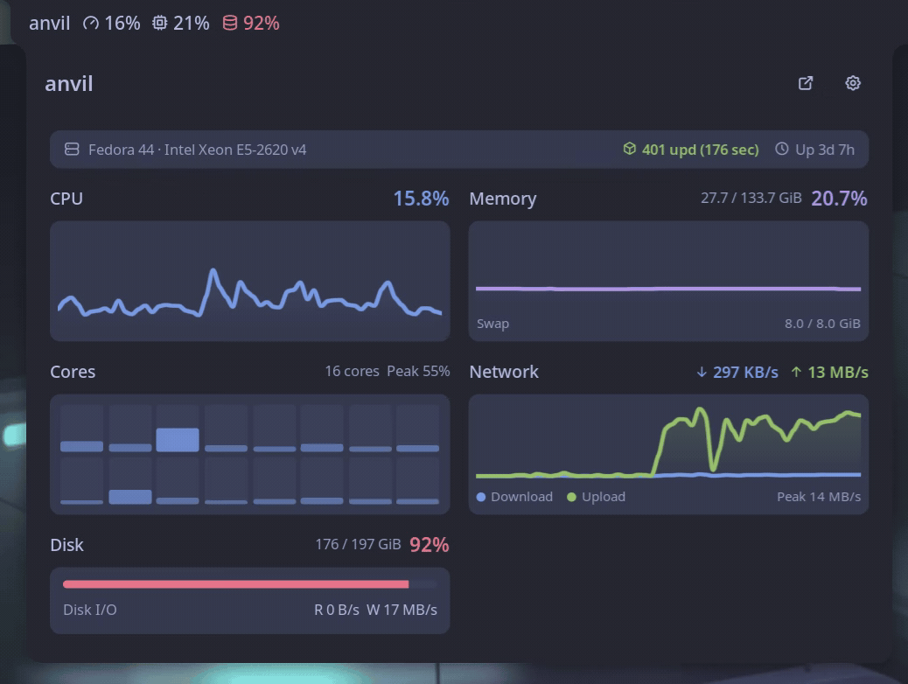

# Noctalia Shell Plugin (v5)

Targets Noctalia Shell v5.5+ (`plugin_api = 48`).

This plugin uses a singleton Luau service (`service.luau`) that streams `beszel-ctl watch --raw --reconnect` from the local `beszel-relay` Unix socket (`$XDG_RUNTIME_DIR/beszel-relay.sock`) and shares live state with any number of independent bar widgets (`bar.luau`) and the attached telemetry panel (`panel.luau`). Hub credentials stay inside `beszel-relay`.

<p align="center">
  
</p>

## Setup

1. Install and start `beszel-relay` + `beszel-ctl` (see [packaging/README.md](../../packaging/README.md)).
2. Install the plugin into Noctalia's user plugins directory:
   ```sh
   mkdir -p ~/.local/share/noctalia/plugins
   ln -sfn /path/to/beszel-desktop/shells/noctalia ~/.local/share/noctalia/plugins/beszel-desktop
   ```
3. Enable `henriksvensson/beszel-desktop` in **Noctalia Settings → Plugins**.
4. Place one or more independent host widgets on your bar in `~/.config/noctalia/config.toml`:
   ```toml
   [widget.beszel-workstation]
   type = "henriksvensson/beszel-desktop:bar"
   system = "workstation"

   [widget.beszel-server]
   type = "henriksvensson/beszel-desktop:bar"
   system = "server"
   ```
   Then add `"beszel-workstation"` / `"beszel-server"` to your bar's widget list.

## Features

- **Shared singleton stream:** One `beszel-ctl watch --raw --reconnect` connection serves all bar widget instances and the panel; disabling the plugin terminates the stream and lets `beszel-relay` pause `rt_metrics` polling automatically.
- **Per-instance host pills:** Compact `<host>` + CPU (`cpu-usage`) and Memory (`memory`) glyphs with fixed-width zero-padded (`00%`–`99%`) percentages, structured tooltips, vertical bar layout support, and theme-native severity coloring (`primary`/`secondary` → `tertiary` → `error`).
- **Slim real-time panel (`henriksvensson/beszel-desktop:panel`):** Clicking any host pill opens the attached panel focused on that host, with host switcher chips, hover-scrubbable CPU & memory `ui.graph` traces, and a frame-interpolated per-core CPU heatmap with hover inspection.

## IPC Testing

```sh
noctalia msg panel-toggle henriksvensson/beszel-desktop:panel
```
